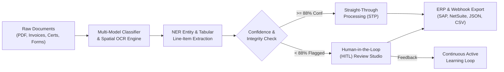

# CogniDoc AI — Enterprise Intelligent Document Processing (IDP) Platform

[](https://opensource.org/licenses/MIT)
[](#)
[](#)

CogniDoc AI is an end-to-end, enterprise-grade **Intelligent Document Processing (IDP)** platform. It automates data ingestion, classification, spatial OCR, entity extraction, tabular line-item parsing, and ERP integration for unstructured documents (PDFs, invoices, receipts, tax forms, compliance certificates, and clinical lab reports).

---

## 🚀 Quick Launch

You can open the platform immediately in your default browser:
```powershell
Start-Process "c:\Users\kbhan\OneDrive\Desktop\Student  tech\index.html"
```
Or simply double-click **`index.html`** in this folder!

---

## 🌟 Key Platform Capabilities



### 1. Document Studio & Interactive Spatial Canvas
- **Multi-Model Document Classification**: Neural and statistical classification across 6 standard enterprise document formats with probabilistic confidence scoring.
- **Interactive Bounding Box Overlays**: Synchronized vector overlays color-coded by semantic entity category (Header/Metadata, Counterparties, Financials, Tables, and Low-Confidence flags).
- **Bi-Directional Hover**: Hovering or clicking any field in the sidebar smoothly scrolls to and pulses its bounding box on the document sheet (and vice-versa).
- **Interactive Box Tagging**: Click-and-drag drawing tool allowing operators to capture custom regions and assign them directly to schema fields with spatial coordinate mapping `[y, x, w, h]`.
- **Canvas Navigation**: Pan, zoom (40% to 250%), 90° rotation, and fit-to-screen presets.

### 2. Multi-Type Document Showcase
- **Acme Corp Commercial Tax Invoice**: $14,850.00 B2B invoice with quarterly subscriptions, GPU cloud clusters, SLA managed services, and corporate seal.
- **Artisan Bistro & Grill Dining Receipt**: Restaurant expense slip with line items, tax, credit card auth code, and low-confidence tip flag for HITL review.
- **IRS Form W-2 Wage & Tax Statement**: Tax withholding statements with masked SSN, employer EIN, and Box 1–6 wage breakdown.
- **Bureau Global Veritas ISO 9001:2015 Certificate**: Accreditation seal, certified scope, issue/expiry dates, and registration number.
- **BioHealth Diagnostic Clinical Lab Report**: Comprehensive blood panel (Glucose, Cholesterol, HDL, HbA1c) with clinical reference ranges.
- **Nexus Cybernetics Mutual NDA**: Legal contract with effective dates, governing law, disclosing/receiving parties, and executed signatures.
- **Universal File Ingestion**: Drag-and-drop or file upload for custom PDFs and image scans with real-time OCR parsing.

### 3. Human-in-the-Loop (HITL) & Continuous Active Learning
- **Integrity & Arithmetic Balancing Checks**: Verifies `Subtotal + Tax == Grand Total`.
- **Inline Field Corrections**: Real-time confidence recalculation when fields are modified.
- **Active Learning Feedback Loop**: Tracks model retraining boosts (+0.2% accuracy recorded per operator correction).

### 4. Batch Processing Pipeline
- High-volume asynchronous queue simulator with Straight-Through Processing (STP) telemetry.
- Progress bars, processing latency, and token counters.

### 5. Schema Studio & Custom Model Builder
- Configurable extraction schemas with model IDs (e.g. `cls_finance_invoice_v3`).
- Custom confidence approval threshold slider (70% – 99%).
- Field definition manager with Regex and NLP pattern enforcement.

### 6. Model Telemetry & ROI Dashboard
- **Cost Savings Calculator**: Demonstrates $42,910+ saved across 28,450 documents.
- **Manual Hours Eliminated**: Real-time counter showing 1,422+ manual entry hours saved (~3.2 mins/doc).
- **Interactive SVG Visualizations**:
  - Daily Ingestion & STP Rate stacked bar chart.
  - Multi-class Document Distribution donut visualizer.
  - Field Extraction Confidence Spectrum bell curve with threshold indicator.
  - Continuous Active Learning accuracy growth curve (+4.1% MoM).

### 7. Enterprise Integration & Export
- **JSON Schema Export**: Formatted, validated schema with full spatial metadata.
- **CSV Line-Item Export**: Standardized comma-separated values ready for Excel / Google Sheets.
- **ERP Webhook Simulation**: Simulated HTTP POST dispatch to SAP, Oracle NetSuite, QuickBooks, or Salesforce.

---

## ⌨️ Keyboard Shortcuts

| Shortcut | Action |
|---|---|
| `B` | Toggle Bounding Boxes |
| `T` | Toggle OCR Text Layer |
| `H` | Toggle Confidence Heatmap |
| `D` | Draw & Tag Custom Bounding Box |
| `+` / `-` | Zoom In / Out |
| `0` | Reset / Fit to Screen |
| `R` | Rotate 90° Clockwise |
| `Esc` | Cancel Current Action / Close Modals |

---

## 📁 File Structure

- [index.html](file:///c:/Users/kbhan/OneDrive/Desktop/Student%20%20tech/index.html) — Application entrypoint with 4 tabbed workspaces.
- [styles.css](file:///c:/Users/kbhan/OneDrive/Desktop/Student%20%20tech/styles.css) — Modern dark/light theme, glassmorphism, responsive layout.
- [app.js](file:///c:/Users/kbhan/OneDrive/Desktop/Student%20%20tech/app.js) — Core OCR/NLP engine, spatial coordinate mapper, HITL logic, charts, exports.
- [idp_platform_architecture.md](file:///c:/Users/kbhan/OneDrive/Desktop/Student%20%20tech/idp_platform_architecture.md) — Comprehensive technical architecture specification.
