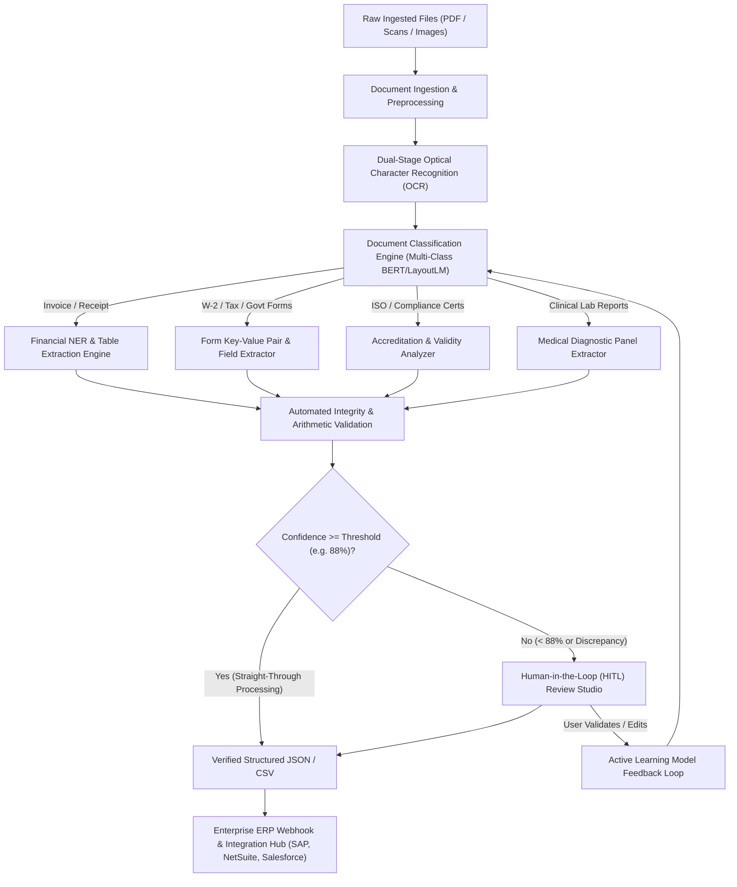

# CogniDoc AI — Enterprise Intelligent Document Processing (IDP) Platform

## 1. Executive Summary

**CogniDoc AI** is an end-to-end, enterprise-grade Intelligent Document Processing (IDP) platform. It eliminates manual data entry and accelerates document throughput by combining:
1. **Multi-Model Document Classification**: Neural & statistical classifiers (Visual CNN, LayoutLM, and BERT embeddings) to identify invoices, receipts, tax forms, compliance certificates, clinical reports, and legal agreements.
2. **Spatial Optical Character Recognition (OCR)**: Bounding-box-level tokenization mapping raw text to precise 2D coordinates `[ymin, xmin, ymax, xmax]` with character-level confidence scores.
3. **Natural Language Processing (NLP) & Named Entity Recognition (NER)**: Structured information extraction for key-value pairs, nested tables, dates, monetary amounts, and counterparty entities.
4. **Human-in-the-Loop (HITL) Active Learning**: Real-time discrepancy detection, arithmetic balancing checks (Subtotal + Tax = Total), and automated model retraining feedback loops.
5. **High-Throughput Batch Processing & Integration**: Asynchronous processing pipeline with Straight-Through Processing (STP) metrics, CSV/JSON exports, and automated ERP webhook dispatch (SAP, Oracle NetSuite, QuickBooks, Salesforce).

---

## 2. Platform Architecture & Workflow



---

## 3. Core Modules & Capabilities

### Module 1: Document Studio & Interactive Spatial Canvas
- **Dynamic Bounding Box Visualization**: Interactive SVG layer rendered synchronously on top of the document sheet. Colored by semantic entity category:
  - 🔵 **Metadata / Header**: Invoice #, dates, tracking numbers.
  - 🟣 **Entities & Counterparties**: Vendor name, customer address, signing parties.
  - 🟢 **Financials**: Net subtotal, tax amounts, grand totals.
  - 🔵 **Tabular Line Items**: Detailed row-by-row service and item breakdowns.
  - 🟠 **Low Confidence (< 85%)**: Highlighted in amber dashed borders for operator review.
- **Bi-directional Focus**: Hovering or clicking any field in the right sidebar instantly pulses and locates its bounding box on the document canvas, and vice-versa.
- **Interactive Annotation Drawer**: Click-and-drag bounding box tool that allows operators to tag and map custom fields with instant coordinate calculations.
- **Canvas Viewport Controls**: Smooth zoom (40% to 250%), pan-and-drag navigation, 90° rotation, and fit-to-screen presets.

### Module 2: Pre-Loaded Multi-Type Enterprise Showcase
The platform includes 6 realistic, high-fidelity synthetic documents:
1. **Acme Corp Commercial Tax Invoice**: $14,850.00 B2B invoice with quarterly subscriptions, GPU cloud clusters, SLA managed services, and corporate seal.
2. **Artisan Bistro & Grill Dining Receipt**: Restaurant expense slip with line items, tax, credit card auth code, and low-confidence tip flag.
3. **IRS Form W-2 Wage & Tax Statement**: Tax withholding statements with masked SSN, employer EIN, and Box 1–6 wage breakdown.
4. **Bureau Global Veritas ISO 9001:2015 Certificate**: Accreditation seal, certified scope, issue/expiry dates, and registration number.
5. **BioHealth Diagnostic Clinical Lab Report**: Comprehensive blood panel (Glucose, Cholesterol, HDL, HbA1c) with clinical reference ranges.
6. **Nexus Cybernetics Mutual NDA**: Legal contract with effective dates, governing law, disclosing/receiving parties, and executed signatures.
7. **Universal File Ingestion**: Drag-and-drop support for any user-uploaded image or document with client-side OCR parsing.

### Module 3: Batch Processing Pipeline
- Real-time queue monitor displaying processing latency, token counts, and auto-classification scores.
- Straight-Through Processing (STP) rate tracker (87.5% baseline target).
- Asynchronous batch execution simulator with live progress notifications.

### Module 4: Schema Studio & Custom Model Builder
- Configurable extraction schemas with model IDs (e.g. `cls_finance_invoice_v3`).
- Custom confidence approval threshold slider (70% – 99%).
- Field definition manager with Regex and NLP pattern enforcement.
- Automated arithmetic balancing rule: `Subtotal + Tax == Total`.

### Module 5: Model Telemetry & Business ROI Dashboard
- **Cost Savings Calculator**: Demonstrates $42,910+ saved across 28,450 documents.
- **Manual Hours Eliminated**: Real-time counter showing 1,422+ manual entry hours saved (~3.2 mins/doc).
- **Interactive SVG Visualizations**:
  - Daily Ingestion & STP Rate stacked bar chart.
  - Multi-class Document Distribution donut visualizer.
  - Field Extraction Confidence Spectrum bell curve with threshold indicator.
  - Continuous Active Learning accuracy growth curve (+4.1% MoM).

---

## 4. File Locations

| File | Path | Description |
|---|---|---|
| Main Application | [index.html](file:///c:/Users/kbhan/OneDrive/Desktop/Student%20%20tech/index.html) | Complete semantic HTML5 structure with 4 tabbed workspaces. |
| Design System | [styles.css](file:///c:/Users/kbhan/OneDrive/Desktop/Student%20%20tech/styles.css) | Modern dark/light theme, glassmorphism, responsive split-screen studio. |
| Core Engine | [app.js](file:///c:/Users/kbhan/OneDrive/Desktop/Student%20%20tech/app.js) | OCR bounding box renderer, NLP entity extraction, HITL logic, charts, exports. |

---

## 5. How to Launch & Explore

Open the application directly in any modern browser:
```
file:///c:/Users/kbhan/OneDrive/Desktop/Student  tech/index.html
```
Alternatively, launch via Windows PowerShell:
```powershell
Start-Process "c:\Users\kbhan\OneDrive\Desktop\Student  tech\index.html"
```

